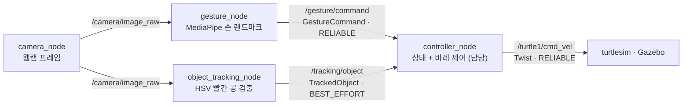

# ✋ Gesture-Controlled Object Tracking Robot — 손 제스처로 켜고 끄는 물체 추적 로봇

<p align="center">
  
  
  
  
  
  
</p>

손 제스처로 로봇의 물체 추적을 켜고 끕니다. **보자기 → 추적 시작, 주먹 → 정지.** 카메라가 HSV 색상으로 빨간 공을 찾으면, 화면 중심 대비 위치 · 면적 오차를 속도 명령으로 바꿔 turtlesim(2D) · Gazebo(3D) 로봇이 공을 따라갑니다.

Gazebo의 로봇을 실제 AMR로 보고, 빨간 공이 가까워지는 것을 벽 · 장애물에 가까워지는 상황으로 가정했습니다. 공이 화면에서 커질수록 감속해 목표 거리에서 정지하고, 출발 · 정지는 사람의 손동작으로 제어합니다.

> ROKEY 9기 스터디 **5인 팀 프로젝트** · 2026.07.10 ~ 08.05 — 팀 저장소 [Jik-Kim/study-project](https://github.com/Jik-Kim/study-project)를 fork해 내 역할을 덧붙인 개인 포트폴리오판입니다.
>
> **내 역할(황인재):** 상태 · 이동 제어 — `controller_node` · 제어 알고리즘 · 추적 상태 머신 → [내가 한 것](#-내가-한-것)

## 💡 한눈에

ROS 2의 노드 · 토픽 · rosidl 메시지 · 파라미터 · launch를 익히면서, 카메라 하나로 **손 제스처와 물체를 함께 인식해 로봇을 움직이는** 시스템을 5명이 나눠 만들었습니다.

```text
웹캠 ─┬─▶ 손 제스처 인식(MediaPipe) ──▶ START / STOP ─────────┐
      └─▶ 빨간 공 검출(HSV) ──▶ 위치 오차 error_x · 면적 area ─┴─▶ 제어 노드(상태 + 비례 제어) ──▶ 속도 명령 ──▶ turtlesim · Gazebo 로봇
```

| 동작 | 방법 |
|---|---|
| 추적 시작 · 정지 | 보자기 → `START`, 주먹 → `STOP`, 손이 없거나 애매하면 `NONE`(이전 상태 유지) |
| 회전 | 공이 화면 왼쪽이면 왼쪽으로, 오른쪽이면 오른쪽으로 — 위치 오차에 비례 |
| 전진 | 공이 작게(멀리) 보일수록 빠르게, 목표 크기에 가까워지면 감속 · 정지 — 면적 오차에 비례 |
| 안전 정지 | 주먹 · 공 미검출 · 추적 신호 끊김이면 즉시 정지 |

## 🛠️ 시스템 구조



| 노드 | 역할 |
|---|---|
| `camera_node` | 웹캠 프레임 캡처 → `/camera/image_raw` 발행 |
| `gesture_node` | MediaPipe 손 랜드마크 → `START` / `STOP` / `NONE` 명령 |
| `object_tracking_node` | HSV 필터로 빨간 공 검출 → 위치 오차(`error_x/y`) · 면적(`area`) 계산 |
| **`controller_node`** | **제스처 · 추적 오차 → `geometry_msgs/Twist` 속도 명령 (담당)** |
| `main_ui` | Tkinter 4분할 화면(영상 · 상태 · 토픽 흐름 · 속도 그래프) |

<details>
<summary>패키지 · 메시지 · 문서</summary>

| 패키지 | 내용 |
|---|---|
| `gesture_robot_interfaces` | 메시지 2개 — `GestureCommand`(명령 · 신뢰도) · `TrackedObject`(검출 여부 · 위치 오차 · 면적) |
| `gesture_robot` | 노드 · 핵심 로직(`core/` — 색 추적 · 제스처 분류 · 추적 상태 · 이동 제어) · 어댑터(OpenCV · MediaPipe · turtlesim) · 시각화 · UI |
| `sim_bringup` | turtlesim · Gazebo(TurtleBot3) 실행 launch |

팀이 합의한 기준은 [docs/SOT.md](docs/SOT.md), 노드 사이 약속은 [docs/interfaces.md](docs/interfaces.md), 데이터 흐름은 [docs/architecture.md](docs/architecture.md), 환경 설정은 [docs/setup.md](docs/setup.md)에 있습니다.

</details>

## 📊 결과

- 팀 통합 테스트에서 게인을 보정한 뒤, 제스처로 추적을 시작 · 정지하며 turtlesim · Gazebo 로봇이 공을 따라가는 시연을 했습니다(8/4 촬영, 영상은 이 저장소에 없음).
- 단위 시험 **7개 통과** — 제어기(`test_tracking_controller.py`) 3개 · 색 검출(`test_color_tracker.py`) 4개.

## 🙋 내가 한 것

제스처와 추적 오차를 받아 로봇 속도 명령을 만드는 **상태 · 이동 제어 파트**를 맡아, `controller_node` · `tracking_controller.py` · `tracking_state.py`를 설계 · 구현했습니다.

1. **제어 인터페이스 약속** — 팀 회의에서 제어 노드가 받을 데이터 규약을 제안해 확정하고 [docs/SOT.md](docs/SOT.md) · [docs/interfaces.md](docs/interfaces.md)에 반영했습니다.
   - 오차 부호: `error_x = 공 중심 x − 화면 중심 x`(오른쪽 +, 왼쪽 −)
   - 거리는 검출 면적(`area`)으로 근사하고, `error_y`는 이번 범위에서 쓰지 않음(필드만 유지)
   - QoS: 제어 명령 `RELIABLE`, 추적 결과 `BEST_EFFORT`(KEEP_LAST, depth 1)
   - STOP · 미검출 · 메시지 끊김 때 정지하는 규칙
2. **제어 알고리즘** (`core/tracking_controller.py`)
   - 회전 `angular_z = −angular_gain × error_x`, 전진 `linear_x = linear_gain × (target_area − area)` — 비례 제어 · 중앙 / 목표 면적 deadband · 최대 속도 제한
   - 공이 너무 크게 잡히면 후진하지 않고 정지
   - 계산 결과를 `VelocityCommand` 값 객체로 돌려줘 제어 로직과 ROS 계층을 나눔
3. **추적 상태 머신** (`core/tracking_state.py`) — 초기 상태 `STOP`, 제스처로 `START` / `STOP` 전이, `NONE`은 이전 상태 유지
4. **제어 ROS 2 노드** (`nodes/controller_node.py`)
   - 이동 제어 파라미터 8종을 선언해 실행 중 튜닝 가능
   - `/gesture/command`(RELIABLE) · `/tracking/object`(BEST_EFFORT) 구독 → `/turtle1/cmd_vel` 발행
   - **안전 정지 3가지:** STOP 제스처 즉시 정지 · `detected=false` 즉시 정지 · 10 Hz 타이머로 추적 신호가 끊기면 정지. 다시 검출되고 상태가 `START`면 자동으로 이어 감
5. **시험 · 튜닝** — `TrackingController` 단위 시험(목표 면적에서 정지 · 과대 검출 때 후진 안 함 · STOP · 미검출 때 0 속도)을 쓰고, 통합 테스트 뒤 게인 초깃값을 `0.004`로 보정했습니다.

그 외로 `sim_bringup` 패키지를 처음 만들고 turtlesim / Gazebo bringup launch를 처음 작성했습니다(이후 4분할 UI · Gazebo 확장은 통합 담당 팀원이 발전시킴). 통합 · 시각화 · 검증 파트의 리뷰도 맡았습니다. 관련 PR: [#2](https://github.com/Jik-Kim/study-project/pull/2) · [#14](https://github.com/Jik-Kim/study-project/pull/14) · [#18](https://github.com/Jik-Kim/study-project/pull/18)

## 🧩 기술적 도전 · 배운 점

| 문제 | 해결 | 배운 점 |
|---|---|---|
| 제스처 명령과 추적 결과는 성격이 다르다 | 제스처 명령은 유실되면 안 되어 `RELIABLE`, 추적 결과는 최신값이 중요해 `BEST_EFFORT`로 나눔 | 한 노드 안에서도 토픽 성격에 따라 QoS를 달리해야 함 |
| 추적 메시지가 끊겨도 구독 콜백만으로는 알 수 없다 | 마지막 수신 시각을 검사하는 10 Hz 타이머로 타임아웃 정지 | "신호 없음"은 따로 감시해야 함 |
| 게인이 크면 목표 면적 부근에서 진동, 작으면 반응이 느림 | deadband와 함께 통합 테스트로 게인 `0.004`로 맞춤 | 비례 제어는 실제 화면에서 튜닝해야 함 |
| MediaPipe 설치가 `numpy`를 2.x로 올려 ROS 2 Jazzy `cv_bridge`와 충돌(`KeyError: 16`) — 팀 공통 | `numpy==1.26.4` + `mediapipe==0.10.14`로 고정하고 [docs/setup.md](docs/setup.md)에 기록 | ROS 2와 함께 쓰는 Python 패키지는 버전을 고정해야 함 |

## ⚠️ 한계

- 실제 로봇이 아니라 turtlesim · Gazebo 시뮬레이션에서만 동작합니다.
- 거리는 검출 면적으로 근사하고 `error_y`는 쓰지 않았습니다. 색은 HSV로 빨간 공 하나만 찾아 조명에 민감합니다.
- 8/4 시연 영상은 이 저장소에 없습니다.

## 👥 팀 · 역할

| 파트 | 맡은 것 |
|---|---|
| 제스처 인식 | 카메라 입력에서 손 제스처 명령과 신뢰도 출력 |
| 객체 추적 | 지정 색상의 검출 여부와 위치 오차 출력 |
| **상태 및 이동 제어 (황인재)** | **추적 오차와 상태 입력으로 로봇 제어 · 통합 파트 리뷰** |
| ROS 2 통신 및 인터페이스 | 메시지 빌드 · 최소 Pub/Sub · 노드 통신 골격 |
| 통합 · 시각화 · 검증 | 전체 launch · 공통 파라미터 · 4분할 화면 · 통합 테스트 · Gazebo 확장 |

파트마다 주 담당 1명과 리뷰 담당 1명을 두고, 입력부터 출력까지 검증 가능한 단위와 최소 시험을 함께 책임졌습니다([docs/SOT.md](docs/SOT.md)).

## 🚀 실행 방법

<details>
<summary>의존성 · 빌드 · turtlesim / Gazebo 실행</summary>

```bash
# 1. Python 의존성 (ROS 2 Jazzy 와 맞는 조합 — 버전 고정 필수)
pip install --break-system-packages "numpy==1.26.4" "mediapipe==0.10.14"

# 2. 빌드 · 환경 로드
cd ros2_ws
source /opt/ros/jazzy/setup.bash
colcon build --symlink-install
source install/setup.bash

# 3-a. turtlesim 2D 통합 실행
ros2 launch sim_bringup turtlesim_bringup.launch.py

# 3-b. Gazebo 3D (TurtleBot3) 실행
ros2 launch sim_bringup gazebo_bringup.launch.py
```

웹캠이 필요합니다. 단위 시험만 돌리려면 `cd ros2_ws/src/gesture_robot && python3 -m pytest -q test`.

</details>

## 📄 라이선스

MIT License — 원본 팀 저장소 라이선스를 그대로 따릅니다. [LICENSE](LICENSE) 참고.
